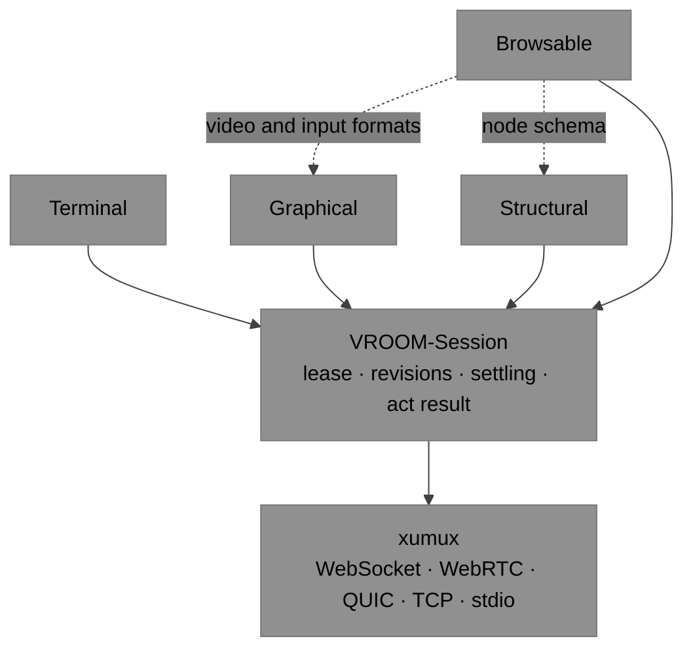

# VROOM

**Virtual Remoting Over Open Methods**

Version: 0.3.0-draft | Status: Draft | Date: 2026-11-08

---

## What is VROOM?

VROOM is a protocol family for remote interactive sessions, for humans and AI agents alike, built on [xumux](https://xumux.org), a transport-agnostic channel multiplexing standard.

VROOM has four types, matched to what is being controlled, on one shared base. They can run over the same xumux connection.

| Protocol | Spec | Description |
|----------|------|-------------|
| **VROOM-Session** | [VROOM-Session.md](./VROOM-Session.md) | The shared base: control lease, revisions and guards, settling, act results |
| **VROOM-Graphical** | [VROOM-Graphical.md](./VROOM-Graphical.md) | Displays and windows as pixels: video, audio, OS-level input, agent screenshots |
| **VROOM-Terminal** | [VROOM-Terminal.md](./VROOM-Terminal.md) | Terminal access — PTY, capability negotiation, Kitty keyboard/graphics, CBOR control plane |
| **VROOM-Structural** | [VROOM-Structural.md](./VROOM-Structural.md) | Native app UI as a tree: one IR; hosts map AX / UIA / AT-SPI |
| **VROOM-Browsable** | [VROOM-Browsable.md](./VROOM-Browsable.md) | Browsers: tabs, page tree, navigation, network, tab video |

## Which type do I use?

| To control | Use | Because |
|---|---|---|
| A shell | Terminal | Bytes are the real interface |
| A web page | Browsable | It understands pages, and needs no OS permissions when it launches the browser |
| A native app | Structural | Names and roles are more reliable than coordinates |
| Anything else, or to watch and take over | Graphical | Pixels always work |

## Implementation

Implementation is under way in a separate repository, starting with Browsable. The specs here remain the source of truth.

## Status

VROOM is in active development. All documents are drafts and subject to change.

## License

MIT
