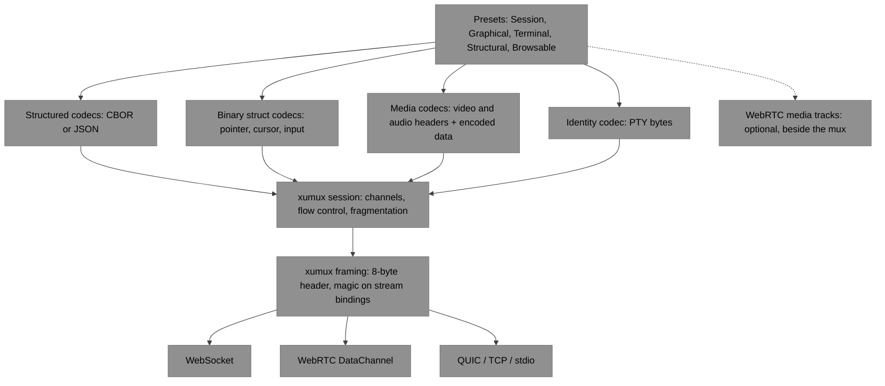
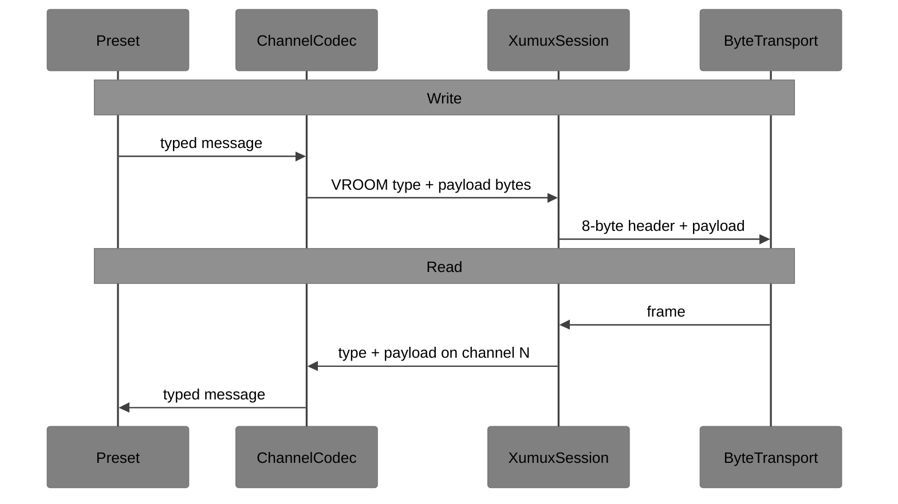

# VROOM I/O Stack

**How to implement VROOM 0.2 on xumux 0.3**

This document is an **implementation guide**. It is not a wire spec, and nothing in it is normative. Where it and a spec differ, the spec wins.

Channel names, message types, encodings and delivery live in the specs:

- [VROOM-Session.md](../VROOM-Session.md): the shared base, `vroom.session`
- [VROOM-Graphical.md](../VROOM-Graphical.md)
- [VROOM-Terminal.md](../VROOM-Terminal.md)
- [VROOM-Structural.md](../VROOM-Structural.md)
- [VROOM-Browsable.md](../VROOM-Browsable.md)
- [VROOM-Services.md](../VROOM-Services.md): optional SFTP and TCP services, whose byte streams use `pipe/1` independently of the session's structured encoding

Mux framing, channel lifecycle and transport bindings live in [xumux](https://xumux.org) 0.3 ([spec repo](https://github.com/deftai/xumux), [core](https://github.com/deftai/xumux/blob/main/spec/core.md)). xumux describes its own layers in [docs/design/io-stack.md](https://github.com/deftai/xumux/blob/main/docs/design/io-stack.md). The TypeScript mux implementation is [libxumux](https://github.com/deftai/libxumux).

---

## The seam

xumux frames and demuxes. Each VROOM channel owns its payload codec.

- **xumux** owns the transport binding and the frames: the 8-byte header, fragmentation, flow control, channel IDs, and each channel's effective delivery properties.
- **Each VROOM channel** owns what is inside the payload: CBOR or JSON messages, binary structs, encoded video and audio, raw PTY bytes.

Do **not** put VROOM CBOR, or any other VROOM payload encoding, in the xumux framer. The mux header is `[Channel:2][Type:1][Flags:1][Length:4]`, and the payload after it is opaque to xumux. Codecs decode **after** demux.

The frame **Type** is the VROOM message type, and each channel has its own type space ([Session §1](../VROOM-Session.md#1-on-xumux)). A channel's codec therefore picks the decoder by Type. One channel can carry both kinds: `vroom.graphical.video.<surface>` carries VIDEO_CONFIG as CBOR and VIDEO_FRAME as a binary header followed by the encoded frame.

One xumux connection MAY carry channels of every VROOM type at once. A host MAY also run one process per type, and clients must not assume the types share a process ([Session §2.1](../VROOM-Session.md#21-session_hello-and-session_welcome)).

---

## Subspace vocabulary (inspiration, not a dependency)

Deft's internal Subspace I/O stack is layered as `ByteTransport → Framer → Codec → Connection<TMessage>`, with `MessageTransport` for in-process loops, middleware, and `define*` presets. This guide borrows that vocabulary so implementors can share one mental model. Subspace is **not** a dependency of VROOM. A VROOM stack needs xumux (or libxumux) plus per-channel codecs.

| Subspace role | VROOM on xumux | xumux layer |
|---------------|----------------|-------------|
| `ByteTransport` | WebSocket, WebRTC DataChannel, QUIC, TCP, stdio. Usually **attached** after the transport is established outside the mux. | 1 Transport |
| `Framer` | The xumux session: header, channels, fragmentation, flow control. | 2 Framing, 3 Session |
| `Codec` | **Per channel**, after demux. Selected by the channel's `metadata.profile` and the frame Type. Never in the mux framer. | 5 Profile |
| `Connection<TMessage>` | A typed read/write view of one channel, or of a preset's set of channels. | 5 Profile |
| `MessageTransport` | An in-process or test underlay: typed messages, no bytes. | (tests) |
| `define*` preset | `defineVroomSession`, `defineVroomGraphical`, and so on: which channels to open, the delivery to request, which codec sits on each, thin policy hooks. | 6 Application |

---

## Layers

Video and audio travel on xumux channels on every binding: H.264 is the baseline video codec, and audio is Opus ([Graphical §3](../VROOM-Graphical.md#3-video), [§6](../VROOM-Graphical.md#6-audio)). The dashed path is an option on the WebRTC binding only: a host MAY send video and audio as media tracks next to the DataChannels. STREAM_STATE then reports `source: "track"`, no video channel opens, and track media is not xumux frames ([Graphical §3.5](../VROOM-Graphical.md#35-webrtc-media-tracks)).

### 1. ByteTransport

A bidirectional byte stream or message pipe. xumux does **not** dial.

1. Establish the transport outside the mux: signalling and offer/answer, TCP accept, stdio spawn, QUIC handshake.
2. Hand the established socket, stream or DataChannel to the xumux session.
3. On stream bindings (TCP, stdio), send and check the `XMUX` magic bytes, then frames. WebSocket (subprotocol `xumux`), WebRTC (DataChannel `xumux`) and QUIC (ALPN `xumux`, a design draft) use no magic. See the [xumux bindings](https://github.com/deftai/xumux/tree/main/spec/bindings).

libxumux has adapters for each: `WebSocketAdapter`, `WebRTCAdapter`, `TcpAdapter`, `StdioAdapter` and `QuicAdapter`.

**Every binding's base path is reliable and ordered.** An unreliable channel needs a further path, which only an extension provides: [webrtc-multichannel/1](https://github.com/deftai/xumux/blob/main/spec/extensions/webrtc-multichannel.md) gives each channel its own DataChannel, and quic-multistream/1 (a design draft in xumux) would give QUIC streams and datagrams. Without one, every channel is reliable and ordered, whatever it asked for.

### 2. xumux session

libxumux, or an equivalent, owns:

- the 8-byte header, fragmentation and reassembly
- channel 0: HELLO and WELCOME, OPEN_CHANNEL, CHANNEL_ACK and CHANNEL_REJECT, WINDOW_UPDATE, probes, CLOSE
- channel IDs (the opener picks: client odd, server even) and the **effective** properties reported in CHANNEL_ACK or WELCOME
- per-channel flow control on reliable channels
- demux: each incoming frame goes to the channel that owns it

Channel 0 messages are JSON. That is **mux** control, not VROOM control. VROOM's own control starts on `vroom.session`, which the client opens in HELLO, with HELLO `application: "vroom/1"` and the credentials in HELLO `auth` ([Session §1](../VROOM-Session.md#1-on-xumux)). The mux passes `auth` up. The VROOM host validates it.

A few xumux rules matter to VROOM in particular:

- **Read effective properties.** Code must not assume a channel is unreliable because it asked for that ([Session §1](../VROOM-Session.md#1-on-xumux)). A preset should look the properties up in CHANNEL_ACK and adjust, for example by coalescing pointer moves when the channel is reliable ([Graphical §2](../VROOM-Graphical.md#2-channels)).
- **Size the limits for video.** `maxMessageSize` must exceed the largest frame at the highest bitrate, which isn't always a keyframe ([Session §1](../VROOM-Session.md)), and `initialWindow` must be at least `maxMessageSize`. So a full window can be seconds of video, and xumux credit cannot limit frames in flight. Graphical senders use FRAME_ACK for that ([Graphical §3.3](../VROOM-Graphical.md#33-sender-rules)).
- **Fragmentation is for reliable, ordered channels only.** On other channels a message must fit in one frame, so a VIDEO_SLICE must fit the path's largest message.
- **Schedule input first.** Input and session channels take priority over video and bulk data on a shared path. That is local scheduling, with no wire change. On the base path xumux suggests fragments of at most 16 KiB, interleaved fairly between channels.

### 3. Per-channel codecs

"Structured" means CBOR by default, or JSON where SESSION_WELCOME selected it. SESSION_HELLO and SESSION_WELCOME are always JSON. Binary structs are big-endian. "Requested" delivery is what the opener asks for. The effective delivery may be stronger.

**Session** (`vroom-session/1`)

| Channel | Requested delivery | Codec | Notes |
|---|---|---|---|
| `vroom.session` | Reliable, ordered | JSON for SESSION_HELLO and SESSION_WELCOME, then structured | Opened in HELLO. Lease, WAIT, ACTIVITY, AGENT_STATE, CHAT, ERROR. Everything else opens after SESSION_WELCOME |

**Graphical** (`vroom-graphical/1`)

| Channel | Requested delivery | Codec | Notes |
|---|---|---|---|
| `vroom.graphical.control` | Reliable, ordered | Structured | STREAM_START, STREAM_STATE, VIDEO_CONFIG on the datagram path, STREAM_STATS, PROFILE, CURSOR_SHAPE, clipboard |
| `vroom.graphical.video.<surface>` | Reliable, ordered, unless the client asks for the datagram path | VIDEO_CONFIG structured; VIDEO_FRAME and VIDEO_SLICE a binary header, then encoded video | Opened by the host after STREAM_START. H.264 is the baseline. VIDEO_SLICE is experimental |
| `vroom.graphical.feedback` | Reliable, ordered | Structured | RECEIVER_REPORT, KEYFRAME_REQUEST, NACK, FRAME_ACK |
| `vroom.graphical.cursor` | Unreliable, unordered | Binary struct | CURSOR_POS, with `seq` |
| `vroom.graphical.pointer` | Unreliable, unordered | Binary struct | POINTER_MOVE, POINTER_MOVE_REL, with `seq`. Needs a lease |
| `vroom.graphical.input` | Reliable, ordered | Binary structs; TEXT is UTF-8 | Buttons, scroll, physical keys, text, touch, RELEASE_ALL. Needs a lease |
| `vroom.graphical.agent` | Reliable, ordered | Structured | Screenshots, changed regions, ACT and ACT_RESULT |
| `vroom.graphical.audio.<id>` | Unreliable, unordered for `"timely"`; reliable, ordered for `"complete"` | AUDIO_CONFIG structured; AUDIO_PACKET a binary header, then one Opus packet | Delivery follows the profile ([Graphical §9](../VROOM-Graphical.md#9-profiles)) |

**Terminal**

| Channel | Requested delivery | Codec | Notes |
|---|---|---|---|
| `vroom.terminal.control` | Not stated in the spec | An 8-byte TLV header inside the xumux payload, then the body | HELLO body is always JSON. Later bodies use the negotiated `control_encoding` (CBOR preferred). WINDOW_RESIZE is a binary struct, SIGNAL a `uint8` |
| `vroom.terminal.pty` | Not stated in the spec | Identity | 8-bit clean PTY master bytes. Opened after PTY_RESPONSE |

The Terminal spec predates VROOM-Session and is [pending alignment](../VROOM-Terminal.md) with it. Its own HELLO, authentication and TLV header overlap with SESSION_HELLO, xumux `auth` and the xumux frame Type. Until it is aligned, three things are open: the outer xumux Type to use on `vroom.terminal.control` (the inner TLV carries the real type), the Terminal profile name, and the delivery each channel requests. A byte stream and its control messages need reliable, ordered delivery to work at all, but the spec does not say so yet.

**Structural** (`vroom-structural/1`)

| Channel | Requested delivery | Codec | Notes |
|---|---|---|---|
| `vroom.structural.control` | Reliable, ordered | Structured | STRUCT_HANDSHAKE, SNAPSHOT, FIND, ACT, EVENT, ERROR. The tree IR travels in these messages. Never on an unreliable channel |

**Browsable** (`vroom-browsable/1`)

| Channel | Requested delivery | Codec | Notes |
|---|---|---|---|
| `vroom.browsable.control` | Reliable, ordered | Structured | BROWSE_HELLO, tabs, navigation, the Structural messages `0xA1`–`0xA6`, screenshots, storage, STREAM_START |
| `vroom.browsable.events` | Reliable, ordered | Structured | NETWORK_EVENT, CONSOLE_EVENT, when subscribed |
| `vroom.browsable.video.<tab>` | As Graphical's video channel | Graphical's video codec | The surface is the numeric tab ID |
| `vroom.browsable.feedback` | Reliable, ordered | Graphical's feedback codec | |
| `vroom.browsable.audio.<tab>` | As Graphical's audio channel | Graphical's audio codec | |
| `vroom.browsable.pointer` | Unreliable, unordered | Graphical's pointer codec | |
| `vroom.browsable.input` | Reliable, ordered | Graphical's input codec | |

Browsable's video and input are byte-for-byte Graphical's formats, so one codec implementation can serve both types. Only the channel names and the surface numbering differ.

**The seam rule:** the xumux Type on an application channel is whatever that channel's spec defines (POINTER_MOVE, STRUCT_HANDSHAKE, VIDEO_FRAME, and so on). The mux does not parse CBOR. The channel codec parses the payload, and on `vroom.terminal.control` also the TLV header inside it.

### 4. Presets

The session preset configures xumux HELLO before it is sent: `application`, `auth`, and the request to open `vroom.session`. The other presets are constructors over an xumux session that has completed its handshake, once SESSION_WELCOME has arrived. These names are suggestions, and implementations MAY differ.

| Preset | Opens | Requested delivery | Negotiation | Policy hooks |
|---|---|---|---|---|
| `defineVroomSession` | `vroom.session`, in HELLO | Reliable, ordered | SESSION_HELLO `encodings` → SESSION_WELCOME `encoding`, offered types and surfaces | Lease requests and state, kill switch, audit |
| `defineVroomGraphical` | `control` first; `cursor` and `feedback` to watch; `pointer` and `input` to act; `agent` for agent access; `audio.<id>` when asked. The host opens `video.<surface>` after STREAM_START | As in the codec table | Encoding from SESSION_WELCOME. STREAM_START `codecs` → STREAM_STATE `codec`. PROFILE or STREAM_START `profile` | Lease check on input and actions; clipboard opt-in |
| `defineVroomTerminal` | `vroom.terminal.control`; `vroom.terminal.pty` after PTY_RESPONSE | Open (see above) | Terminal HELLO `control_encoding`, CAPABILITY_OFFER → CAPABILITY_SELECT | Auth, PTY and exec authorisation |
| `defineVroomStructural` | `vroom.structural.control` | Reliable, ordered | Encoding from SESSION_WELCOME; STRUCT_HANDSHAKE caps | Lease check on ACT; snapshot size limit |
| `defineVroomBrowsable` | `control` first; `events` for network and console events; `pointer` and `input` to act; `video.<tab>`, `feedback` and `audio.<tab>` for viewers | As in the codec table | Encoding from SESSION_WELCOME; BROWSE_HELLO capabilities | Lease check on actions; origin policy; `evaluate` and `selectors` gates |

Presets do **not** replace xumux HELLO and WELCOME. They decide which application channels to request, which codec sits on each, and which thin hooks wrap control.

Graphical says "channels open when needed": a watching client opens no input channels, and an agent without a viewer opens no video ([Graphical §2](../VROOM-Graphical.md#2-channels)). Which side opens each channel is stated only for video. For the other channels this guide assumes the client opens them, which is a guess the specs do not confirm.

---

## Write and read path

PTY, pointer, cursor and input are hot paths, and so are the binary headers of VIDEO_FRAME and AUDIO_PACKET. Their codecs should be identity or packed structs, with no JSON or CBOR parse on every byte, sample or frame.

---

## One connection, several types

A host SHOULD accept one xumux connection and open only the channels the client asks for. For example:

- **Watching a desktop:** `vroom.session`, `vroom.graphical.control`, `vroom.graphical.cursor` and `vroom.graphical.feedback`, then the host's `vroom.graphical.video.<surface>`. No lease.
- **Taking over:** a lease on the surface, then `vroom.graphical.pointer` and `vroom.graphical.input`.
- **An agent without a viewer:** a lease, `vroom.graphical.agent`, and no video.
- **A shell:** `vroom.terminal.control`, then `vroom.terminal.pty` once the PTY is allocated.
- **A native app:** a lease, and `vroom.structural.control`. Graphical screenshots are the fallback when the tree cannot serve an action.
- **A web page:** a lease, and `vroom.browsable.control`, plus `vroom.browsable.video.<tab>` for a viewer.

xumux assigns channel IDs, not VROOM. Presets look channels up by **name**.

---

## Middleware

Put policy on the structured control channels: `vroom.session`, each type's control channel, `vroom.graphical.agent`, and `vroom.terminal.control`.

- Validating HELLO `auth`, and capability intersection
- Lease policy: who may take a lease, suspension on local input, the kill switch
- PTY and exec authorisation on Terminal
- Snapshot size limits on Structural, origin policy and the `evaluate` and `selectors` gates on Browsable
- ACTIVITY records for every action, with secrets redacted

Keep **media, PTY, cursor, pointer and input** thin. Do not run auth parsers or CBOR middleware on those channels. The lease check on input is a per-surface state lookup, not a parser: a host ignores input without a lease and sends ERROR `4600` at most once a second ([Graphical §4](../VROOM-Graphical.md#4-input)). A control-plane refusal should not sit in the PTY copy loop.

---

## Testing

The Subspace-style split works well:

1. **Codec round trips.** For each channel codec, `decode(encode(msg))` equals `msg`, and fixed hex vectors where a spec gives them. No socket.
2. **`MessageTransport` or an in-memory underlay.** Preset state machines with typed messages and no bytes: SESSION_HELLO → SESSION_WELCOME → LEASE_REQUEST → open `input`; STREAM_START → the host opens the video channel; Terminal HELLO → capabilities → PTY.
3. **An in-memory ByteTransport.** libxumux, or a stub framer, over a paired pipe, to check the layering: VROOM CBOR never appears in the 8-byte header, PTY bytes cross the mux unchanged, and a preset copes with a channel whose effective delivery is reliable when it asked for unreliable.

Codec and preset tests should not need WebRTC, a live PTY, a screen or a browser.

---

## Related projects

| Repo | Role |
|------|------|
| [deftai/xumux](https://github.com/deftai/xumux) | Mux protocol: framing, channels, transport bindings |
| [deftai/libxumux](https://github.com/deftai/libxumux) | TypeScript mux and transport adapters |
| This repo | VROOM application protocols, and this guide |

---

## Status

Draft guidance for implementors, for VROOM 0.2 on xumux 0.3. Wire changes belong in the protocol specs, not here.

## License

MIT
